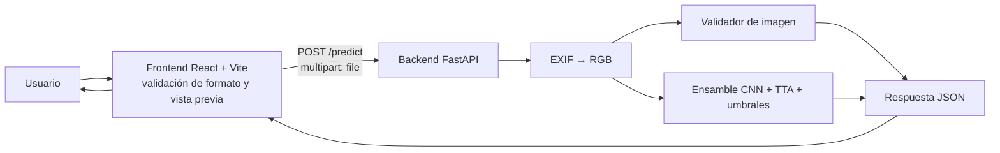

# YucaAI

YucaAI clasifica fotografías de hojas de yuca en tres clases: hoja sana (`healthy`), estría parda (`cbsd`, *Cassava Brown Streak Disease*) y mosaico (`cmd`, *Cassava Mosaic Disease*). Es un proyecto del curso de Ciencias de la Computación de la Universidad Santo Tomás, Bucaramanga.

La aplicación entrega puntuaciones de un modelo de aprendizaje automático; no constituye un diagnóstico agronómico definitivo. Ante síntomas en cultivo, el resultado debe confirmarse con personal técnico o un laboratorio fitosanitario.

El documento principal del trabajo es **“Artículo integrado – Detección de mosaico y estría parda en yuca”**. Su ubicación en el repositorio está pendiente de confirmar.

## Tabla de contenidos

- [Arquitectura](#arquitectura)
- [Estructura del repositorio](#estructura-del-repositorio)
- [Requisitos](#requisitos)
- [Puesta en marcha rápida](#puesta-en-marcha-rápida)
- [Backend](#backend)
- [Frontend](#frontend)
- [Uso desde un celular](#uso-desde-un-celular-en-la-misma-red)
- [Solución de problemas](#solución-de-problemas)
- [Resultados del proyecto](#resultados-del-proyecto)
- [Limitaciones y trabajo futuro](#limitaciones-y-trabajo-futuro)
- [Créditos y licencia](#créditos-y-licencia)

## Arquitectura



La inferencia se ejecuta en el servidor porque allí se cargan los cuatro modelos TensorFlow/Keras. El navegador solo valida el formato, presenta la vista previa y envía la imagen original; no descarga ni ejecuta los modelos.

## Estructura del repositorio

El árbol siguiente se obtuvo del sistema de archivos y omite dependencias, compilados y cachés (`node_modules`, `.venv`, `dist` y `__pycache__`).

```text
YucaAI/
├── README.md                         # Este documento
├── backend/
│   ├── .gitignore                    # Ignora modelos, entorno, cachés y logs
│   ├── main.py                       # API FastAPI, CORS y contrato HTTP
│   ├── models.py                     # Carga y configuración de los cuatro modelos
│   ├── inference.py                  # TTA, ensamble ponderado y umbrales
│   ├── validator.py                  # Validación visual y advertencias
│   ├── requirements.txt              # Dependencias Python fijadas
│   ├── models/                       # Pesos .keras; se distribuyen aparte
│   └── yucasana1.jpg, yucamozaico1.jpg, yucaestria1.png, perro.jpg
│                                      # Imágenes locales de prueba
└── frontend/
    ├── .env.example                  # Configuración de ejemplo de Vite
    ├── README.md                     # Documentación específica del frontend
    ├── docs/API_CONTRACT.md          # Resumen del contrato HTTP
    ├── package.json                  # Scripts y dependencias Node
    ├── public/                       # Favicon e imágenes estáticas
    └── src/
        ├── components/               # Interfaz: carga, resultado, layout y comunes
        ├── config/                   # Variables, API, clases y configuración visual
        ├── context/ y hooks/         # Estado temporal y lógica de interacción
        ├── services/                 # Cliente HTTP, API y adaptador de respuesta
        ├── types/                    # Tipos TypeScript
        ├── utils/                    # Validación, formato, errores y tonos
        └── App.tsx, main.tsx, styles/ # Entrada y estilos de la aplicación
```

También están disponibles [la guía del frontend](frontend/README.md) y [el contrato API resumido](frontend/docs/API_CONTRACT.md). Si hubiera discrepancia, prevalece el código de `backend/main.py` y los módulos de `frontend/src/`.

## Requisitos

- Python de 64 bits entre 3.10 y 3.13; se recomienda Python 3.12. TensorFlow 2.21 no dispone de paquetes para Python 3.14.
- Node.js 18.18 o superior y npm. `frontend/package.json` declara `node >=18.18`.
- Aproximadamente 2–3 GB libres para dependencias y modelos, y RAM suficiente para cargar cuatro redes.

Dependencias confirmadas en `backend/requirements.txt`: FastAPI 0.115.0, Uvicorn 0.30.6, TensorFlow 2.21.0, Pillow 10.4.0, NumPy 2.1.3, OpenCV headless 4.10.0.84 y `python-multipart` 0.0.9. El frontend usa React 18.3.1, Vite 5.4.11, TypeScript ~5.6.3 y Tailwind CSS 3.4.15, según `frontend/package.json`.

## Puesta en marcha rápida

Abra dos terminales desde la raíz del repositorio.

### Windows (PowerShell)

```powershell
# Terminal 1: backend
cd backend
py -3.12 -m venv .venv
.\.venv\Scripts\Activate.ps1
python -m pip install -r requirements.txt
uvicorn main:app --host 0.0.0.0 --port 8000
```

```powershell
# Terminal 2: frontend
cd frontend
Copy-Item .env.example .env
npm install
npm run dev
```

### macOS/Linux

```bash
# Terminal 1: backend
cd backend
python3 -m venv .venv
source .venv/bin/activate
python -m pip install -r requirements.txt
uvicorn main:app --host 0.0.0.0 --port 8000
```

```bash
# Terminal 2: frontend
cd frontend
cp .env.example .env
npm install
npm run dev
```

El frontend de desarrollo se sirve en el puerto 5173 por configuración de Vite. El backend escucha en el puerto 8000. Abra la URL que muestre Vite en la terminal.

## Backend

### Modelos y ejecución

Coloque estos cuatro archivos en `backend/models/` con estos nombres exactos:

- `densenet121.keras`
- `efficientnetv2b0.keras`
- `mobilenetv3large.keras`
- `resnet50v2.keras`

Los modelos requeridos se distribuyen por separado en [Google Drive](https://drive.google.com/file/d/16Fopu-MjvG2FEK1jEhh5f5HiD7Vg4jpH/view?usp=drive_link).

Para desarrollo puede añadir `--reload`:

```bash
uvicorn main:app --host 0.0.0.0 --port 8000 --reload
```

No se recomienda `--reload` para inferencias cotidianas: cada cambio reinicia el proceso y vuelve a cargar los cuatro modelos.

Swagger está disponible en `http://localhost:8000/docs`. También puede consultar salud y predicción:

```bash
curl http://localhost:8000/
curl -F "file=@ruta/a/hoja.jpg" http://localhost:8000/predict
```

En Windows use `curl.exe`:

```powershell
curl.exe http://localhost:8000/
curl.exe -F "file=@C:\ruta\a\hoja.jpg" http://localhost:8000/predict
```

### Contrato HTTP

| Método y ruta | Uso |
| --- | --- |
| `GET /` | Salud; devuelve estado, servicio, clases y endpoints. Incluye `accuracy_test`, que debe interpretarse como exploratoria. |
| `GET /docs` | Interfaz Swagger de FastAPI. |
| `POST /predict` | Recibe `multipart/form-data` con el campo obligatorio `file`. |

Ejemplos ilustrativos de respuesta; los valores no son resultados garantizados.

```json
{
  "valid": true,
  "confiable": true,
  "prediccion": "healthy",
  "nombre_clase": "Hoja Sana",
  "confianza": 0.81,
  "probabilidades": { "cbsd": 0.08, "cmd": 0.11, "healthy": 0.81 },
  "recomendacion": "...",
  "advertencias": [],
  "metricas_validacion": { "ratio_vegetal": 0.42, "entropia": 0.31 }
}
```

```json
{
  "valid": false,
  "confiable": false,
  "message": "La imagen no parece una hoja de yuca válida.",
  "razon": "...",
  "metricas_validacion": { "confianza_modelo": 0.36, "entropia": 0.91, "ratio_vegetal": 0.02 },
  "sugerencias": ["...", "...", "..."]
}
```

```json
{ "detail": "El archivo debe ser una imagen (JPG, PNG, etc.)" }
```

El último ejemplo corresponde a un 400. Un error interno usa HTTP 500 y el campo `detail` con el prefijo `Error procesando la imagen:`.

### Pipeline de inferencia y validación

1. FastAPI lee el archivo, aplica la orientación EXIF, lo convierte a RGB y lo redimensiona a 224 × 224. El preprocesamiento específico está dentro de cada modelo.
2. Cada red evalúa cuatro vistas: original, volteo horizontal, rotación de 90° y rotación de 270°; se promedian sus probabilidades.
3. El ensamble pondera DenseNet121 con 3, EfficientNetV2B0 con 2, MobileNetV3Large con 1 y ResNet50V2 con 1.
4. Se prioriza CBSD si su probabilidad es al menos 0,20. Si no, se prioriza CMD si alcanza 0,15. En otro caso se usa la clase de mayor probabilidad.
5. El validador rechaza una imagen si no contiene al menos 5 % de verde de hoja o 25 % de marrón de hoja enferma, o si su región central no tiene al menos 15 % de contenido vegetal. Advierte, sin rechazar, ante textura inusual, confianza máxima menor a 55 % o entropía mayor a 0,85.

Por los umbrales, `prediccion` puede diferir de la clase con la mayor probabilidad. El frontend debe mostrar la clase reportada por el servidor. El campo `confiable` es verdadero cuando la confianza de la clase elegida es al menos 0,70.

### CORS y privacidad

CORS acepta actualmente cualquier origen (`allow_origins=["*"]`) para desarrollo. En producción, sustituya ese valor por los dominios explícitos del frontend y limite métodos/cabeceras según la infraestructura.

Por defecto el backend no guarda imágenes. Solo crea `debug_imgs/ultima_entrada.jpg` si se define `YUCAAI_DEBUG=1` antes de iniciar el proceso. Ese modo debe usarse únicamente para depuración local y nunca con imágenes que no se deban conservar.

## Frontend

Instale dependencias, copie la configuración y ejecute:

```bash
cd frontend
npm install
cp .env.example .env
npm run dev
npm run build
npm run preview
```

En PowerShell, sustituya `cp` por `Copy-Item`. Las variables `VITE_*` se leen al arrancar Vite; reinicie `npm run dev` después de cambiar `.env`.

| Variable | Valor de `.env.example` | Uso |
| --- | --- | --- |
| `VITE_API_BASE_URL` | `http://localhost:8000` | URL del backend, sin `/api`. |
| `VITE_API_HEALTH_PATH` | `/` | Ruta de salud. |
| `VITE_API_PREDICT_PATH` | `/predict` | Ruta de predicción. |
| `VITE_API_IMAGE_FIELD` | `file` | Campo multipart de la imagen. |
| `VITE_API_TIMEOUT_MS` | `90000` | Tiempo máximo de la solicitud en milisegundos. |
| `VITE_MODEL_NAME` | `Ensamble de 4 CNN + TTA` | Nombre visible del sistema de inferencia. |
| `VITE_API_MODEL_ID` | vacío | No se envía al backend actual. |
| `VITE_API_MODEL_FIELD` | vacío | Nombre del campo opcional para otro backend. |
| `VITE_IMAGE_PLANT` | `images/yuca.webp` | Imagen visual de marca. |
| `VITE_IMAGE_LEAF` | `images/yuca_hoja.webp` | Imagen ilustrativa de la carga. |

La pantalla permite seleccionar, arrastrar o tomar una imagen con el selector nativo. Acepta JPEG, PNG y WebP; el código no fija un límite de tamaño. Valida formato y que el navegador pueda decodificar la imagen, muestra una vista previa y estados de carga, cancelación y error. El resultado incluye clase, barras de puntuación, recomendación del servidor y advertencias. Una respuesta `valid: false` se muestra como imagen rechazada, con razón y sugerencias, sin barras.

El frontend no usa `localStorage`, cookies, historial, exportaciones ni modelos en el navegador. Su estado se pierde al recargar la página. La imagen se transmite al backend para inferencia; el comportamiento de conservación del backend se describe en la sección de privacidad anterior.

## Uso desde un celular en la misma red

1. Conecte computador y celular a la misma red Wi-Fi.
2. Inicie el backend con `--host 0.0.0.0`.
3. En `frontend/.env`, configure `VITE_API_BASE_URL` con la IP local del computador, por ejemplo `http://192.168.1.20:8000`, y reinicie Vite.
4. Inicie el frontend con `npm run dev -- --host` y abra desde el celular la dirección que Vite muestre para la red.
5. Permita los puertos 8000 y 5173 en el firewall si el sistema lo solicita.

El botón “Tomar foto” usa el selector nativo con `capture="environment"`; no requiere HTTPS para este flujo local.

## Solución de problemas

| Síntoma | Causa probable | Solución |
| --- | --- | --- |
| “Backend sin conexión” o error CORS | Backend apagado, URL incorrecta o origen no permitido. | Compruebe `GET /`, revise `VITE_API_BASE_URL` y CORS. |
| 404 en `/predict` | URL base con `/api` adicional. | Use `http://localhost:8000`, sin `/api`. |
| `FileNotFoundError` de `.keras` | Falta un modelo o el nombre no coincide. | Descargue los cuatro archivos y colóquelos en `backend/models/`. |
| Error instalando TensorFlow | Python 3.14, arquitectura de 32 bits o entorno incorrecto. | Use Python 3.10–3.13 de 64 bits, preferiblemente 3.12, y cree de nuevo `.venv`. |
| `Activate.ps1` bloqueado | Política de ejecución de PowerShell. | Ejecute `Set-ExecutionPolicy -Scope Process -ExecutionPolicy Bypass` y active de nuevo el entorno. |
| Tiempo agotado en la primera predicción | Carga inicial, compilación o inferencia CPU. | Espere; el timeout del frontend es 90 000 ms. |
| Puerto 8000 ocupado | Otro proceso escucha en ese puerto. | Identifique el PID con `netstat -ano | findstr :8000` y cierre ese proceso o use otro puerto y actualice `.env`. |
| `.env` no se aplica | Vite ya estaba iniciado. | Detenga y reinicie `npm run dev`. |
| Foto iPhone en HEIC | El frontend no admite HEIC/HEIF. | Use “Más compatible” en iPhone o exporte la foto a JPEG. |

## Resultados del proyecto

Los siguientes valores provienen del artículo integrado y deben interpretarse con sus limitaciones.

| Elemento | Resultado | Nota |
| --- | --- | --- |
| Dataset | 35.001 imágenes; 11.667 por clase | División por clase: 8.166 entrenamiento, 1.750 validación y 1.751 prueba. El aumento de datos se aplicó antes de dividir, lo que puede sobrestimar métricas. |
| DenseNet121 | 93,20 % exactitud; F1 macro 0,9317 | Resultado en prueba informado por el artículo. |
| EfficientNetV2B0 | 93,11 % exactitud | Resultado en prueba informado por el artículo. |
| MobileNetV3Large | 92,33 % exactitud; 3,00 M parámetros | Resultado en prueba informado por el artículo. |
| Ensamble con umbrales | 96,74 % | Exploratorio: pesos y umbrales se eligieron usando etiquetas del mismo conjunto de prueba. No es una precisión validada; requiere datos independientes. |

Consulte **“Artículo integrado – Detección de mosaico y estría parda en yuca”** como fuente principal de metodología y resultados.

## Limitaciones y trabajo futuro

- Validar externamente con fotografías de campo independientes.
- Ajustar los umbrales con un conjunto de validación independiente.
- Mejorar el rendimiento de inferencia en CPU.
- Restringir CORS para despliegues reales.
- Desplegar con HTTPS.
- Mantener `YUCAAI_DEBUG` desactivado y eliminar cualquier imagen de depuración cuando ya no sea necesaria.

## Créditos y licencia

- Autores: Pendiente de definir.
- Curso: Ciencias de la Computación, Universidad Santo Tomás, Bucaramanga.
- Docente: Pendiente de definir.
- Licencia: Pendiente de definir.
